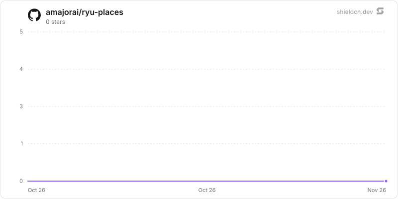

<p align="center">
  <picture>
    <source media="(prefers-color-scheme: dark)" srcset="./icon-dark.png" />
    
  </picture>
</p>

<div align="center">

# Places

</div>

A shared family map of places to visit and places been, with a Places Guide agent, MCP tools, a map Companion, and one SQLite source of truth.

> **The public home of `ryu-places`.** Source, builds, and releases live here —
> binaries for every platform are attached to each release.
>
> This tree is generated from the Ryu monorepo, so commits pushed here
> directly are replaced on the next sync. **Pull requests are welcome** —
> open them here and they are ported into the monorepo, then flow back out.
> Ryu as a whole: https://github.com/amajorai/ryu

## Install

**App:** [Install](ryu://apps/@ryu/places) (opens the Ryu desktop app and asks you to confirm)

**CLI:**

```bash
ryu apps add @ryu/places
```

**From source:**

```bash
cargo build --release --manifest-path backend/Cargo.toml
```

Prebuilt binaries for every platform are attached to [each release](https://github.com/amajorai/ryu/releases).

## License

Apache-2.0 — see [LICENSE](./LICENSE).

## What it does

- **Saved** — search real places (OpenStreetMap data through a Photon geocoder), save them as *want to go* or
  *been here*, rate and date visits, keep a personal note and a note for
  everyone, or drop a pin anywhere. Every member keeps their own mark on a
  shared place, so the list can say who has been and who still wants to go.
- **Trips** — dated trips (or a day count until dates are set) with a
  day-by-day itinerary, an *Ideas* bucket, numbered day-colored stops and
  route lines on the map, straight-line distance per day, and one-click route
  optimization (nearest neighbour + 2-opt, keeping the day's first stop).
  Bookings (flights, stays, trains, tickets…), shared costs split between
  chosen members with balances and settle-up transfers, and a checklist.
- **Import** — paste a TikTok, Instagram, YouTube, blog, or list link (or just
  a caption or a friend's message) and the model picks out the places it
  mentions, with tips like what to order; or import a Google Takeout
  *Saved Places.json*, a saved-list CSV, or KML from Google My Maps. You review
  the candidates on the map and choose what to save.
- **Draft days with AI** — describe what you want ("slow mornings, great ramen,
  one museum") and get a day-by-day draft that reuses saved places where they
  fit. Nothing is added until you accept it.

## How the AI features stay grounded

The model only proposes names (plus a city hint, category, note, and for plans
a day and time). Every coordinate comes from the geocoder or from a place
already on the map, and a geocoder hit must match the proposed name, so an
invented venue shows up under "Couldn't find on the map" instead of landing on
a random pin. Shared captions and pages are treated as untrusted data: the
system prompts say so and only fixed fields survive parsing. Nothing is saved
without confirmation.

The model is Ryu's side model, reached through Core's `hook:side-model` host
callback (declared in both the sidecar's `host_api.grants` and the manifest's
`permission_grants`). The HTTP API is bearer-gated on the `RYU_EXT_TOKEN`
Core injects and fails closed without one, so a standalone run must set
`RYU_EXT_TOKEN` itself (and send it as `Authorization: Bearer …`) or every
route answers 401. With a token but no reachable Core (`RYU_CORE_PORT`,
`RYU_EXT_PLUGIN_ID`), only the AI routes answer 503; everything else keeps
working.

Link reading is a server-side fetch, so it is locked down: `https` only, the
destination must resolve to public addresses (re-checked on every redirect),
10 s timeout, 1.5 MB cap. TikTok and YouTube are read through their public
oEmbed endpoints; other pages are reduced to title, description, and visible
text. Login-walled posts (often Instagram) ask for the pasted caption.

## Sharing

Sharing follows organization membership. Core stamps every proxied request
with the caller's user id and, when they belong to one, their organization id:

| Caller | Map |
| --- | --- |
| user in an org | one map + trips shared by everyone in that org |
| user without an org | a personal map |
| unstamped, unmanaged node (single-user node, standalone run) | the node-local map |
| unstamped, managed node (`RYU_MANAGED_NODE`) | rejected with 403 |

Malformed stamps, an org stamp without a user, and a user id equal to a
reserved member (`local`, `agent:places`) are rejected rather than mapped to a
default.

Each tenant is a separate SQLite file under the app's own data dir,
`plugin-data/@ryu+places/` (`places.db` for the local map,
`tenants/<hex tenant>.db` otherwise), so one org can never read another's rows
through a missed filter. Members appear the first time they open the app and
can set their display name and color.

## Agent tools

The manifest-owned MCP server `places` exposes: `search`, `list`, `get`,
`save`, `update`, `delete`, `lists`, `create_list`,
`rename_list`, `overview`, `trips`, `trip`, `create_trip`, `update_trip`,
`add_stop`, `add_stops`, `move_stop`, `remove_stop`, `optimize_day`,
`add_booking`, `add_expense`, `add_todo`, `check_todo`, `import_link`,
`suggest_itinerary`.

**Shared MCP lane.** Core forwards no caller identity into a stdio MCP server,
so the server never guesses one. It serves only the single map (tenant) that
turned agent access on (`PUT /agent { enabled }`, the *Places Guide agent
access* switch in the Companion's profile panel), and it acts there as the
`agent:places` member ("Places Guide"), never as `local`/Owner or any person.
The holder is recorded in `agent.db` beside the maps, because the HTTP sidecar
and the MCP child are separate processes, and it is re-read on every tool
call. Agent access starts off; at most one map holds it and no map can take it
from another. The first request from an `org:` map marks the node as
organization-bound: that drops access held by a personal (`local` or `user:`)
map and keeps personal maps from taking it afterwards, so an organization's
agents are never served the owner's personal map. Every agent on the node
reaches that one map. Lifting this needs a generic Core change that forwards a
verified caller into `tools/call`.

On the lane the agent:

- reads members' marks (status, visit date, rating) without their personal
  mark notes;
- cannot set or clear any mark (`mark`/`unmark` are not exposed, and `save`
  drops `status`, `visitedOn`, and `rating`);
- can delete only places it saved;
- must name `paidBy` on an expense: the agent member is never a payer or a
  sharer, and is left out of a trip's `members`.

## Data and privacy

Places, marks, trips, bookings, and costs stay in the node's SQLite store.
Imported links are fetched from their public pages, and their text (or a
pasted caption or message) goes to Ryu's configured model, as do AI trip-draft
requests with the trip's name, destination, dates, stops, and saved place
names. Search text (and the map center as a bias) goes to the
geocoder, and so do imported place names and addresses (Google Maps export
rows without coordinates, and the place names and cities picked out of links,
captions, and messages) and each new AI-drafted stop name with the trip's
destination. The geocoder is the
public Photon instance at `photon.komoot.io` by default, a self-hosted Photon
via `RYU_PLACES_GEOCODER_URL`, or none with `RYU_PLACES_GEOCODER_URL=off`
(pins can still be dropped by hand). The Companion loads basemap tiles from
OpenFreeMap (`tiles.openfreemap.org`), its only CSP widening. Places never
books anything; bookings are records of what you already booked. Distances
are straight-line estimates, not travel times.

## Local sidecar

The process is `ryu-places` (port 8026, `RYU_PLACES_PORT`). For an isolated
run: `RYU_PROFILE=dev RYU_KEYCHAIN=off RYU_DIR=/tmp/ryu-places-dev`.

## Tests

```sh
cargo test -p ryu-places
node --test apps-store/places/manifest.test.mjs
bun run --cwd apps-store/places/ui test
cargo build -p ryu-places && bun run --cwd apps-store/places/ui test:e2e
```

The e2e suite drives the real Companion against the real sidecar with a local
geocoder stub and a stand-in for Core's model callback. Set `PLACES_E2E_CHROMIUM` to a Chromium binary when the
installed Playwright browser revision differs.

## At rest

Every map file (`places.db` for the node-local map and `tenants/<hex tenant>.db` for each
personal or organization map) seals its free text per value (`encb:v1:`, each value bound to
its table, column and row id) under the `@ryu/places` plugin subkey Core delivers to the
sidecar (`crypto:seal` in the sidecar's `host_api.grants`). Each map file is its own content
store (`places.db`, `places/tenants/<hex tenant>.db`), so a value copied into another map does
not open. Sealed: member names; list names; place `name`, `address`, `url` and `note`; each
member's mark `note` (bound to the place and the member); the activity feed's copies of place
names and details; trip `name`, `destination` and `note`; stop `name` and `note`; reservation
`title`, `location`, `confirmation` and `note`; expense `title`; checklist `text`. Writes seal
through the `ryu_seal` SQL function and reads open through `ryu_open` (`src/seal_sql.rs`);
place search matches the opened name, address and note. Coordinates (`lat`/`lng`), categories,
geocoder ids (`external_id`), dates, amounts, currencies, member ids, ratings, statuses and
timestamps stay plaintext: the map, routing, budgets and settle-up need them, so a copy of a
map file still shows where saved places are. `agent.db` holds only which tenant granted agent
access and is not sealed. Legacy plaintext rows are sealed when each map opens (resumable,
idempotent; a sealed column that still holds plaintext is walked again), then the WAL is
truncated and freed pages are zeroed (`secure_delete` is on for every connection). A row that
does not open is left out of lists and counted (`/health` `sealing.unreadable_rows`). Key
states (`backend/src/seal_keys.rs`):

- **Compat mode**: under an older Core that delivers no key, a never-sealed map keeps working
  in plaintext and `/health` reports `sealing.state = "compat"` ("waiting for a Ryu update").
- **No key or another key for a sealed map**: `sealing.state = "unhealthy"`, writes are refused
  and the data is kept.
- **Standalone** (no `RYU_PLUGIN_DATA_DIR`): `RYU_MASTER_KEY` if set, else a generated root in
  `<plugin data dir>/secrets/standalone-root.key` (0600) whose key check value is pinned.
- **`ryu-places mcp`** gets no key (Core delivers keys to sidecars only). It runs every tool
  inside the running sidecar (`ryu_sidecar_runtime::handoff`, re-exported as
  `src/sidecar_link.rs`): at start the sidecar writes
  `<plugin data dir>/secrets/sidecar-handoff.json` (0600) with its loopback port and a random
  token minted for that run (never the Core ext token; replaced at every start, removed on
  shutdown). That token opens only `POST /_handoff/mcp/call`, outside the Core-proxied mount,
  which runs the same tool code on the same agent lane. When no sidecar answers, the MCP process
  uses the map itself and never generates a standalone root; before each tool it re-checks the
  map and refuses once the sidecar has sealed it.

The standalone satellite mirror builds `ryu-crypto` from crates.io at the declared version, so
the release train that ships this must publish `ryu-crypto` first (already ordered before app
backends in `tools/publish-crates.sh`).

## Star History

<a href="https://github.com/amajorai/ryu-places/stargazers">
  <picture>
    <source media="(prefers-color-scheme: dark)" srcset="./.github/shieldcn/star-chart-dark.svg" />
    
  </picture>
</a>
